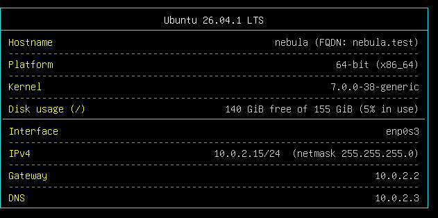

# Pre-Login Banner

This collection of scripts will generate a colored pre-login banner in `/etc/issue` containing real-time host information. It uses a bash script to gather system details and a systemd service to ensure the banner is updated when machine is started or rebooted and appears before the console login prompt.

# Example(s)

Example pre-login banner in version 26.10.19.1820



# Features

The generated banner displays the following system information:

* The operating system name and version.
* The short hostname and Fully Qualified Domain Name (FQDN).
* The platform bit-size (32-bit or 64-bit) and system architecture.
* The current kernel version.
* The disk usage for the root partition (`/`), displaying available space, total size, and the percentage currently in use.
* Per-interface network details, which include the assigned IPv4 address, netmask, default gateway, and DNS servers.
* Automatic filtering of virtual interfaces, skipping loopback, docker, veth, bridge, and container interfaces to keep the banner clean.

# Installation

To install the script and systemd service, run the provided installation script as root:

```bash
sudo bash install.sh
```
## What the installer does?

* Requires root privileges to execute.
* Copies the `update-issue.sh` script to `/usr/local/sbin/update-issue.sh`.
* Copies the `update-issue.service` file to `/etc/systemd/system/update-issue.service`.
* Creates a backup of your current `/etc/issue` file at `/etc/issue.orig` if it does not already exist.
* Reloads the systemd daemon, enables the service to run on boot, and executes the script to build the banner immediately.

# Boot Service Behavior

The `update-issue.service` is a `oneshot` service configured to run after the network targets and before the `getty` login prompts (`tty1` and `ttyS0`). To ensure network information is accurate in the banner, the script will wait up to 20 seconds for a default network route to appear.

# Usage and Testing

Once installed, the banner updates automatically on boot. You can also interact with the script manually:

**Manual Refresh**. 
To instantly update the banner with current system stats, run the script as root:

```bash
sudo update-issue.sh
```

**Preview Mode** 

To test the banner output without overwriting `/etc/issue`, pass a custom file path as an argument:

```bash
update-issue.sh /tmp/preview.txt
```
# Uninstallation / Restoration

To disable the dynamic banner updates and restore your original `/etc/issue` file, execute the following commands:

```bash
sudo systemctl disable update-issue.service
sudo cp /etc/issue.orig /etc/issue
```
